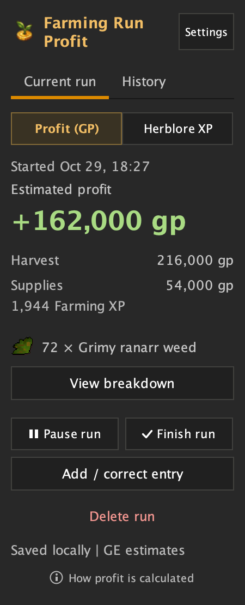
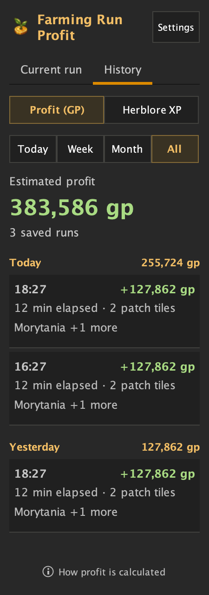
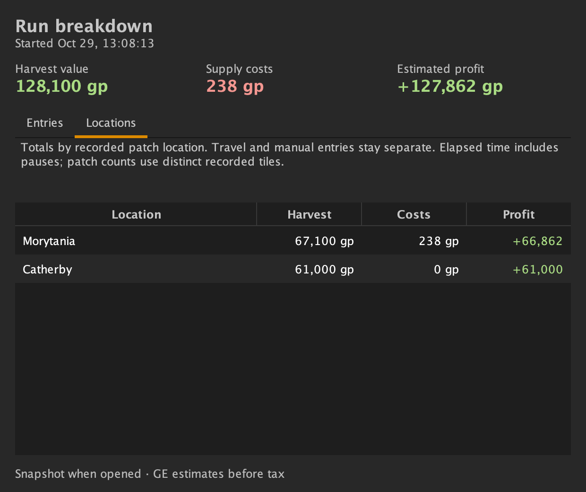
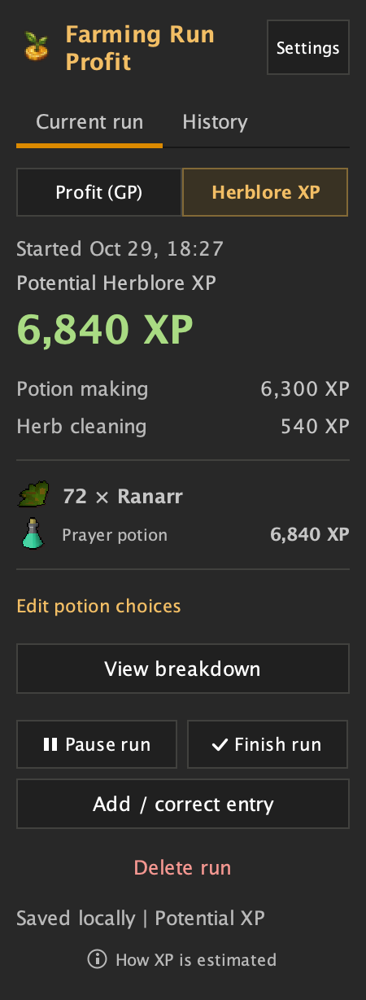
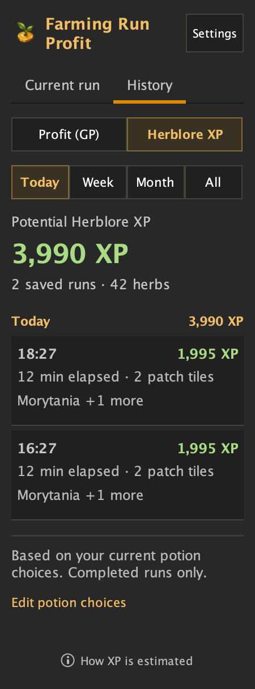

# Farming Run Profit

**See what your farming run earned.** A RuneLite plugin by [Lumby Labs](https://bshelton.github.io/lumby-labs/) that tracks harvest value, supplies and supported travel costs—with herb-sack support, saved run history and an optional potential Herblore XP view.

[Install from the Plugin Hub](https://runelite.net/plugin-hub/show/farming-profit-tracker) · [Read the guide](https://bshelton.github.io/lumby-labs/docs/farming-run-profit/) · [Get help](https://bshelton.github.io/lumby-labs/help/)

## Take a look

**Current run** keeps your profit and costs together. **History** groups saved runs by day, with location summaries and quick access to each breakdown.

<p>
  
  
</p>

Open a run to inspect its entries or compare harvest value and costs by location.



*Screenshots are rendered from the current source with illustrative data. They show the upcoming UI update; Plugin Hub installations may still show the previous layout until the update is published.*

## Start your first run

1. Open RuneLite’s **Plugin Hub**, search **Farming Run Profit**, and install it.
2. Open the plugin sidebar. Harvest or plant a patch to start tracking automatically, or select **Start run**.
3. Farm as usual. Open **View breakdown** to inspect entries or **Add / correct entry** to record a missing cost.
4. Select **Finish run** to save it to **History**. Runs can also finish after the configured idle period.

**Including teleport costs?** Start the run before using your first supported teleport item.

## What you can track

| Feature | What it does |
| --- | --- |
| Harvests | Herbs, allotments, flowers, hops, bushes, cactus, fruit trees and other supported farming crops. Established trees count when harvested. |
| Supplies & travel | Records visible seed/sapling use, detected compost and gardener payments, plus supported basalt, tablet and inventory-scroll teleports. |
| Herb sacks | Uses Farming XP to estimate herbs entering an open sack when they aren’t visible in inventory. Inferred counts are marked for review. |
| Run history | Browse runs by day, filter Today / Week / Month / All, open their ledger, view location totals, or delete a saved run with confirmation. |
| Herblore XP | Estimate XP from harvested herbs, choose a recipe per herb and optionally include cleaning XP. Switch back to GP at any time. |
| Run controls | Pause/resume a run, discard the current run, or add manual entries and corrections. |
| Reminders | Optional reminders for missing magic secateurs, a closed herb sack, or farming while paused. |

History displays 25 runs at a time, with **Load older runs** and **Newer runs** controls. Location names also work with previously saved coordinates; unknown areas keep their coordinates.

## How profit works

**Estimated profit = harvest value − recorded costs for this run.**

Picking fruit from an existing dragonfruit tree adds the fruit’s value. Planting a new tree adds the sapling cost to this run. Earlier planting costs aren’t included.

Prices are GE estimates saved with each entry, **before sale tax**. Moving, banking or noting produce does not count as another harvest.

## Planning Herblore training

Select **Herblore XP** in the sidebar, then **Edit potion choices**. Pick what you plan to make from each herb and choose whether to include cleaning XP. Select **Done** to save, or **Back** to discard edits.

<p>
  
  
</p>

These are **potential XP estimates**, not XP already earned. They assume you have all secondaries and use base XP. Your current choices also recalculate past runs; the saved GP ledger stays unchanged. History includes completed runs only, by local start date. Week starts Monday; Month means the current calendar month.

## A few things to know

- **Some costs need manual entries:** spell runes, jewellery charges, scroll-book teleports, Fertile Soil supplies, seed-box use and missed gardener payments.
- **Sack counts are estimates:** the plugin doesn’t directly read sack contents. Check review notes and correct mismatches. A visible sack chat message is not required.
- **Location totals use recorded entries:** travel and manual costs stay separate. Patch counts are distinct recorded tiles; elapsed time includes pauses.
- **Farming only:** birdhouses, Hespori loot, contract rewards, minigame rewards and non-farming income aren’t tracked automatically.

See the [detailed tracking reference](docs/TRACKING.md#limitations) for supported-cost rules, inference limits and testing coverage.

## Help & your data

[Report a bug](https://github.com/bshelton/farming-profit/issues/new?template=bug_report.yml) or [ask a question / suggest a feature](https://github.com/bshelton/farming-profit/issues). Include what happened, what you expected and a screenshot if useful.

History stays on your computer, separated by RuneScape profile. **The plugin sends no custom telemetry.** For missing or unreadable history, see the [recovery guide](docs/RECOVERY.md). Share only relevant diagnostic excerpts, not your entire RuneLite log.

## Development

Use Java 21 to develop; plugin bytecode targets Java 11.

```sh
./gradlew check
./gradlew run
```

For Jagex Accounts, see [RuneLite’s development-client login instructions](https://github.com/runelite/runelite/wiki/Using-Jagex-Accounts). `./gradlew preview` renders sample UI screenshots without interacting with the game.

[Testing notes](docs/TESTING.md) · [Plugin Hub checklist](docs/PLUGIN_HUB.md) · [Technical details & references](docs/TRACKING.md)
